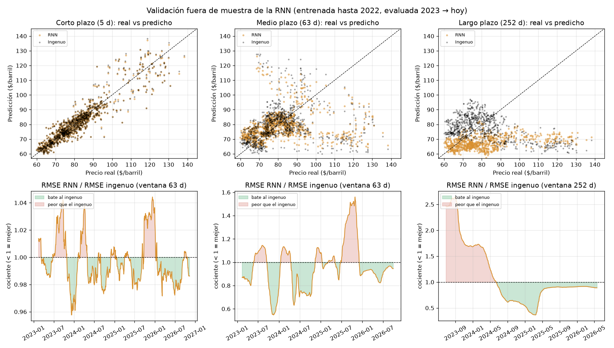

# Validación fuera de muestra: métricas y análisis de errores

Modelo entrenado con datos hasta el 31/12/2022 y evaluado con lo que ocurrió después (02/01/2023 → 11/11/2026, 1008 días de origen). Errores en $/barril. *Ingenuo* = el precio futuro es el de hoy.

## 1. Métricas por red y horizonte

- **R² sobre el precio**: 1 − SSE/SST. Con precios tan autocorrelacionados, el precio de hoy ya "explica" casi todo a corto plazo (por eso el ingenuo también saca un R² alto), y a medio y largo plazo puede ser negativo para todos los modelos si el precio se movió poco en el test y luego dio un salto.
- **R² fuera de muestra (R²ₒₒₛ)** frente al ingenuo (Campbell y Thompson, 2008): 1 − MSE/MSE_ingenuo. Es la métrica habitual en predicción financiera: > 0 significa que el modelo elimina parte del error cuadrático de suponer que el precio no cambia.

### Corto plazo (5 días hábiles)

| Modelo | MAE | MSE | RMSE | R² precio | R²ₒₒₛ vs ingenuo | Acierto dirección |
|---|---|---|---|---|---|---|
| **RNN** | 3,63 | 28,92 | 5,38 | 0,862 | +2,3 % | 53,9 % |
| LSTM | 3,65 | 29,34 | 5,42 | 0,860 | +0,9 % | 52,1 % |
| GRU | 3,64 | 29,15 | 5,40 | 0,860 | +1,5 % | 53,6 % |
| Combinación (referencia) | 3,64 | 29,11 | 5,40 | 0,861 | +1,7 % | 54,6 % |
| Ingenuo | 3,66 | 29,61 | 5,44 | 0,858 | — | — |

### Medio plazo (63 días hábiles)

| Modelo | MAE | MSE | RMSE | R² precio | R²ₒₒₛ vs ingenuo | Acierto dirección |
|---|---|---|---|---|---|---|
| **RNN** | 10,71 | 277,11 | 16,65 | -0,256 | +14,1 % | 62,1 % |
| LSTM | 11,21 | 301,01 | 17,35 | -0,364 | +6,7 % | 62,2 % |
| GRU | 10,92 | 294,57 | 17,16 | -0,335 | +8,6 % | 63,3 % |
| Combinación (referencia) | 10,88 | 289,16 | 17,00 | -0,310 | +10,3 % | 64,9 % |
| Ingenuo | 11,59 | 322,46 | 17,96 | -0,461 | — | — |

### Largo plazo (252 días hábiles)

| Modelo | MAE | MSE | RMSE | R² precio | R²ₒₒₛ vs ingenuo | Acierto dirección |
|---|---|---|---|---|---|---|
| **RNN** | 14,70 | 423,37 | 20,58 | -0,602 | +10,4 % | 79,9 % |
| LSTM | 13,50 | 432,84 | 20,80 | -0,637 | +8,4 % | 73,5 % |
| GRU | 17,02 | 551,47 | 23,48 | -1,086 | -16,6 % | 65,3 % |
| Combinación (referencia) | 14,41 | 455,88 | 21,35 | -0,725 | +3,6 % | 73,7 % |
| Ingenuo | 15,56 | 472,76 | 21,74 | -0,788 | — | — |

## 2. ¿Cuándo acierta y cuándo se equivoca? (RNN frente al ingenuo)

Mejora del RMSE (%) de la RNN frente al ingenuo dentro de cada grupo de orígenes; entre paréntesis, RMSE de la RNN en $/barril. Positivo = la RNN se equivoca menos que el ingenuo.

### Por año de origen

| Año | Corto plazo | Medio plazo | Largo plazo |
|---|---|---|---|
| 2023 | +0,5 % (3,62) | +6,2 % (9,48) | -69,2 % (15,61) |
| 2024 | +0,5 % (2,90) | +9,9 % (5,51) | +43,7 % (6,82) |
| 2025 | +0,2 % (3,24) | +4,7 % (12,98) | +9,2 % (32,33) |
| 2026 | +1,5 % (9,69) | +7,9 % (33,94) | — (sin valor real aún) |

### Por régimen de volatilidad del mercado

Volatilidad realizada del Brent a 20 días (anualizada) en el día de origen, por terciles del test: **calma** ≤ 27 %, **normal** 27–37 %, **turbulencia** > 37 %.

| Régimen | Corto plazo | Medio plazo | Largo plazo |
|---|---|---|---|
| Calma | +0,2 % (3,07) | +8,2 % (15,34) | +14,1 % (15,12) |
| Normal | +1,2 % (3,82) | +2,1 % (12,19) | +3,9 % (24,19) |
| Turbulencia | +1,3 % (7,95) | +8,5 % (22,06) | -1,7 % (21,74) |

### Error móvil frente al ingenuo

Porcentaje del periodo de test en el que la RNN bate al ingenuo (cociente de RMSE móvil < 1):

- Corto plazo (ventana 63 d): 66 % del tiempo
- Medio plazo (ventana 63 d): 63 % del tiempo
- Largo plazo (ventana 252 d): 67 % del tiempo

## 3. Peores fallos de la RNN

Los 5 mayores errores absolutos por horizonte (episodios distintos). *Error* = predicción − real.

| Horizonte | Origen | Objetivo | Precio origen | Real | Predicción | Error RNN | Error ingenuo |
|---|---|---|---|---|---|---|---|
| Corto plazo | 28/10/2026 | 04/11/2026 | 119,20 | 91,84 | 119,22 | +27,38 | +27,36 |
| Corto plazo | 11/03/2026 | 18/03/2026 | 90,98 | 118,09 | 91,12 | -26,97 | -27,11 |
| Corto plazo | 08/09/2026 | 15/09/2026 | 106,12 | 130,80 | 106,27 | -24,53 | -24,68 |
| Corto plazo | 16/07/2026 | 23/07/2026 | 81,23 | 105,32 | 81,23 | -24,08 | -24,09 |
| Corto plazo | 27/02/2026 | 06/03/2026 | 71,32 | 95,74 | 71,89 | -23,84 | -24,42 |
| Medio plazo | 08/01/2026 | 07/04/2026 | 63,34 | 138,21 | 65,89 | -72,32 | -74,87 |
| Medio plazo | 07/07/2026 | 02/10/2026 | 71,78 | 135,51 | 74,33 | -61,18 | -63,73 |
| Medio plazo | 07/04/2026 | 03/07/2026 | 138,21 | 68,68 | 126,29 | +57,61 | +69,53 |
| Medio plazo | 20/02/2026 | 20/05/2026 | 72,75 | 108,93 | 74,69 | -34,24 | -36,18 |
| Medio plazo | 30/06/2023 | 27/09/2023 | 74,51 | 97,10 | 72,93 | -24,17 | -22,59 |
| Largo plazo | 18/04/2025 | 07/04/2026 | 69,33 | 138,21 | 71,33 | -66,88 | -68,88 |
| Largo plazo | 15/10/2025 | 02/10/2026 | 62,33 | 135,51 | 69,38 | -66,13 | -73,18 |
| Largo plazo | 26/04/2023 | 12/04/2024 | 79,19 | 93,12 | 65,13 | -27,99 | -13,93 |
| Largo plazo | 29/01/2024 | 15/01/2025 | 83,99 | 83,48 | 66,21 | -17,27 | +0,51 |
| Largo plazo | 09/08/2024 | 29/07/2025 | 81,07 | 73,21 | 62,47 | -10,74 | +7,86 |

